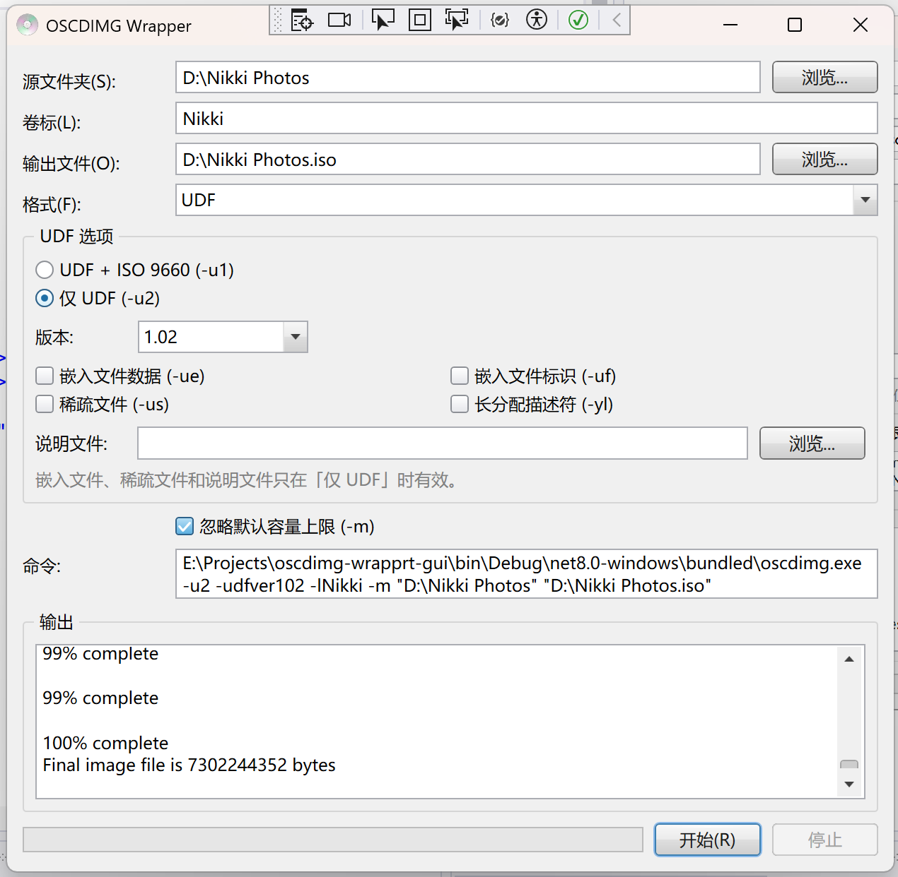

# OSCDIMG Wrapper



## Environments

- [.NET 8 SDK](https://dotnet.microsoft.com/download/dotnet/8.0)

## Build

```powershell
dotnet build
```

## Usage

1. Select the source folder, enter a volume label, and specify the output ISO file. Labels cannot contain spaces and have a maximum length of 32 characters.
2. Select the format.
3. The command to be executed will be displayed below. After confirming, click "Start".

## See Also

* [Oscdimg Command Line Options](https://learn.microsoft.com/windows-hardware/manufacture/desktop/oscdimg-command-line-options)

----------------
by Melina, 2026.10
